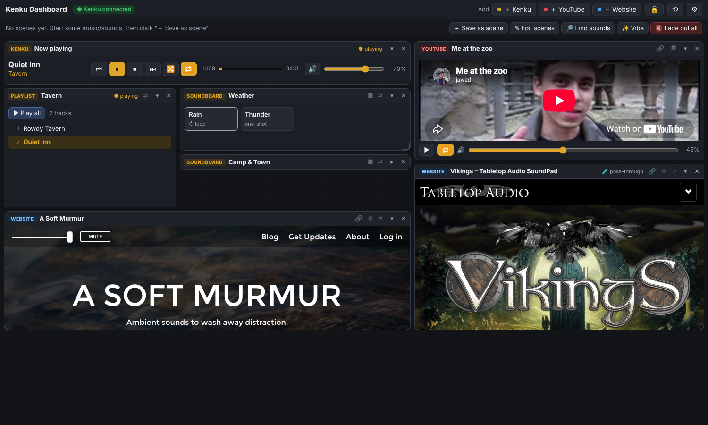
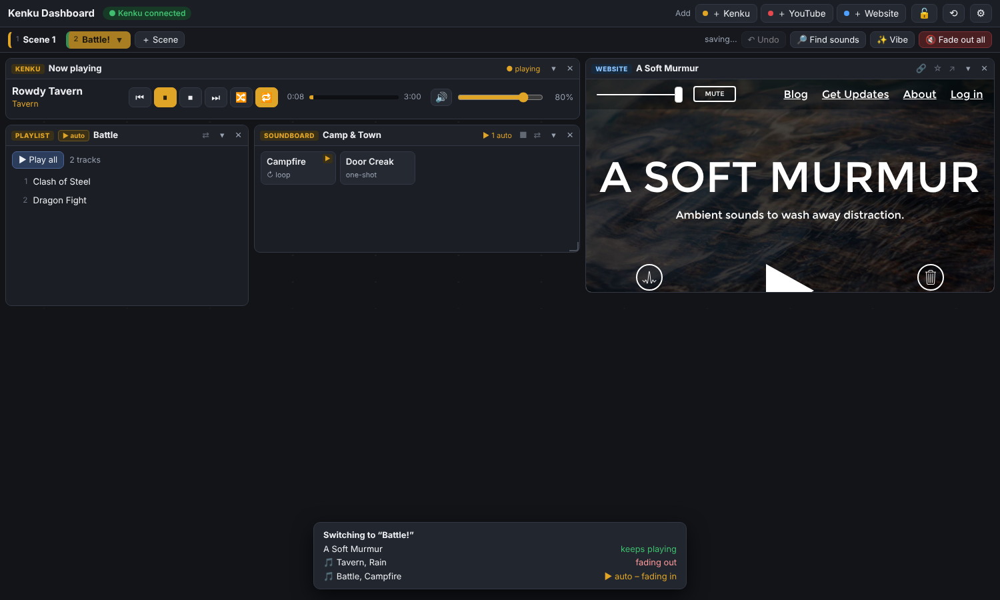
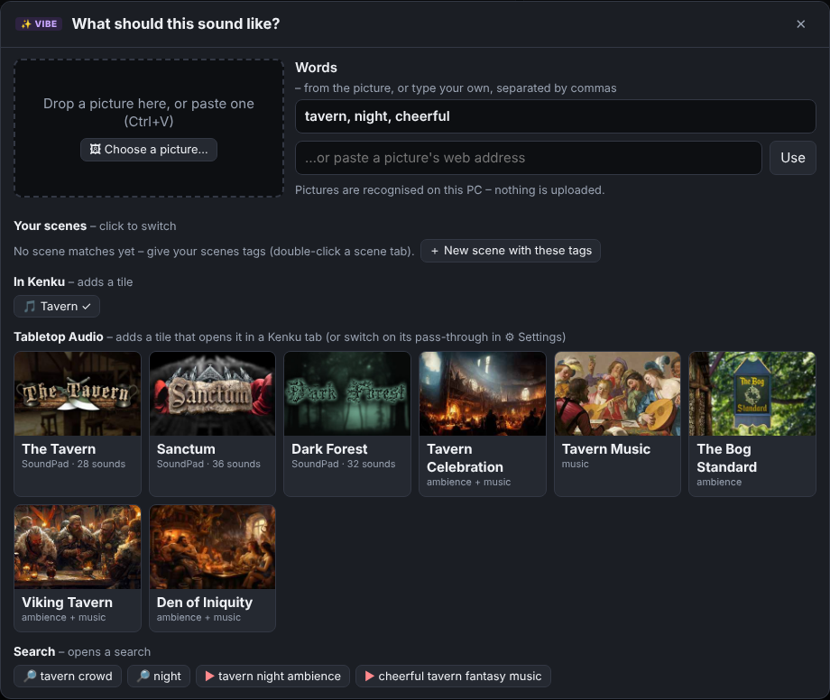
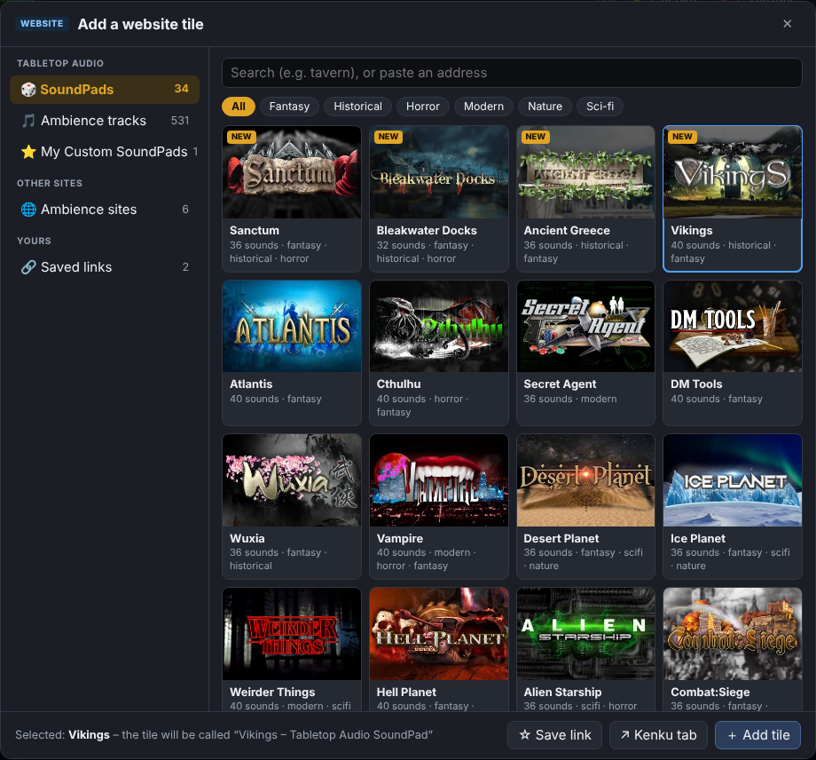
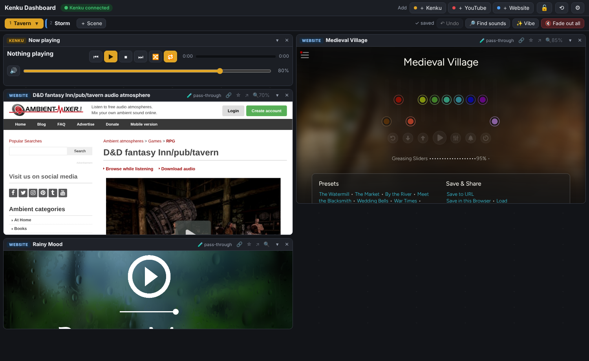
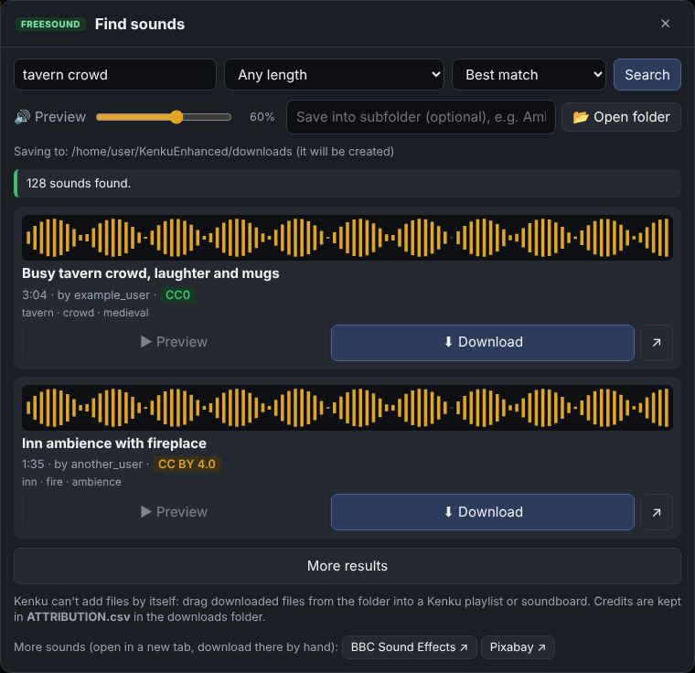

# KenkuEnhanced

A dashboard for [Kenku FM](https://github.com/owlbear-rodeo/kenku-fm) that you open
**inside Kenku's own browser**, so everything it plays goes to Discord. One screen with:

- **Scenes**: each scene is a saved board of tiles. One click (or a number key) switches to it:
  what's in both scenes keeps playing, the rest fades out, and its **▶ auto** items fade in.
- **Tiles on a grid**: everything is a tile you can drag, resize, collapse and close.
  Add tiles with **＋ Kenku**, **＋ YouTube** and **＋ Website** in the top bar.
- **Kenku tiles**: *Now playing* (play/pause/stop/next, shuffle, repeat, volume), one tile per
  **playlist** (click a track to play it) and one per **soundboard** (sounds as pads).
- **YouTube tiles**: as many as you like, each with its own volume and loop, so you can layer
  ambience under music. Paste a link, or **search YouTube** right in the dashboard.
- **Website tiles**: Tabletop Audio SoundPads and ambience tracks, myNoise, Ambient-Mixer and other
  ambience sites, your saved links, or any address. Sites that refuse to be embedded get an "open in
  a Kenku tab" button, or (experimental) can be passed through the helper so they show anyway.
- **✨ Vibe**: show it a picture (a map, scene art) or type a few words, and it suggests
  matching scenes, your Kenku playlists and soundboards, Tabletop Audio SoundPads and tracks, and
  sound / YouTube searches.
- **🔎 Find sounds**: search Freesound, listen to a preview, and download sounds straight into a
  folder on your PC, with the credits written down for you.

Everything you change is saved by itself (into the scene that's showing).



### Arranging tiles
- **Move** a tile by dragging its title bar. **Resize** it from its edges or the corner mark.
- **▾** collapses a tile to just its title bar (it keeps playing); **▸** opens it again.
  **✕** closes it.
- Tiles name themselves after what they show (the video, playlist, soundboard or page).
  **Double-click a name** to give it your own; clear it to go back to the automatic name.
- The **lock** button (padlock, top right) locks the layout so nothing moves by accident during a
  session. The **reset** button (circular arrow) puts the default tiles back in the current scene.
- On a narrow screen (a tablet or phone) the tiles stack in one column.

```
Kenku FM ── built-in browser ──► http://localhost:4000 (this dashboard)
   ▲                                      │
   └── Remote API :3333 ◄── helper ◄──────┘   (the helper fixes the CORS problem)
```

---

## Setup on Windows (first time, about 5 minutes)

### 1. Install KenkuEnhanced
1. Open the [Releases page](https://github.com/GroudonMcL/KenkuEnhanced/releases) and, under the
   newest version, download **`KenkuEnhanced-Setup-vX.Y.Z.exe`**.
2. Run it. Windows may say **"Windows protected your PC"**, because the installer isn't signed (that
   costs money every year). Click **More info → Run anyway**.
3. Click through the installer. It doesn't need administrator rights and includes everything
   (Node.js too). You can tick **Start the helper automatically when I sign in to Windows**.

It installs into `%LOCALAPPDATA%\Programs\KenkuEnhanced` and adds **KenkuEnhanced** to the Start
menu (and the desktop, if you leave that ticked).

<details>
<summary>Other ways: portable ZIP, or the source code</summary>

- **Portable, no installer:** download **`KenkuEnhanced-vX.Y.Z-windows.zip`** from the same page,
  unzip it somewhere easy (e.g. `Documents\KenkuEnhanced`), and use **`Start KenkuEnhanced.bat`**
  inside it. It also includes Node.js and can update itself.
- **Source code** (GitHub's green **Code → Download ZIP**, or `git clone`): you need
  [Node.js](https://nodejs.org) (the **LTS** version) installed first. `Start KenkuEnhanced.bat`
  installs the libraries on the first run. These copies can't update themselves (see **Updating**).
</details>

### 2. Turn on Kenku Remote
In Kenku FM open **Settings** (the cog) → **Remote** → switch it **on**.
Keep the default address `127.0.0.1` and port `3333`.

### 3. Start the helper
Start **KenkuEnhanced** from the Start menu or desktop (or double-click **`Start KenkuEnhanced.bat`**
in its folder). A black window opens and shows:

```
  KenkuEnhanced helper is running.
  Dashboard:  http://localhost:4000
```

**Leave that window open** while you play. Close it to stop the helper.

> The window **is** the helper. If you close it, the dashboard stops working until you start it again.

### 4. Open the dashboard in Kenku
In Kenku FM, click **+** to open a new browser tab, type `http://localhost:4000` and press Enter.
The pill at the top should turn green: **Kenku connected**.

---

## Using a terminal instead (optional)
In the project folder, click the address bar in File Explorer, type `cmd` and press Enter. Then:

```bash
npm install
```
installs the libraries (only needed once, or after updating).

```bash
npm start
```
starts the helper (same as the .bat file).

```bash
npm run check-kenku
```
tests Kenku Remote directly and prints what it finds (it only reads, nothing plays).

```bash
npm run mock-kenku
```
starts a **fake** Kenku so you can try the dashboard with Kenku closed.
Run it in a second window, with the real Kenku closed, because both use port 3333.

## Scenes
**A scene is a saved board**: its tiles, where they are, how big, and what's in them (which
playlist, soundboard, video or website, and their volumes and loop settings). The top bar
shows one tab per scene.

**Everything saves by itself.** Whatever you change on the board (move a tile, add one, change
a volume) is saved into the scene that's showing. **↶ Undo** (or `Ctrl+Z`) takes changes back.

**Make one:** click **＋ Scene**, give it a name, and choose whether it starts as a copy of the
current scene (the same tiles) or as an empty board. Then arrange its tiles.

**Choose what plays when you switch to it (▶ auto):**
- YouTube and playlist tiles have a **▶ auto** switch in their title bar. Gold = on.
- Soundboard pads have a small **▶** in their corner (hover a pad to see it). Gold = this sound
  starts with the scene.
- Kenku plays one playlist at a time, so put ▶ auto on only one playlist per scene.

**Switch:** click a scene tab or press its number key. The smart crossfade:
- anything that's **in both scenes keeps playing** without a gap: the same YouTube video, the
  same website or SoundPad (it isn't even reloaded), the Kenku playlist that's playing if the new
  scene has a tile for it, and Kenku sounds whose soundboard is in the new scene;
- **everything else fades out** (websites can't be faded, so they play until the fade is over);
- the new scene's **▶ auto** items **fade in**. The music fades to the volume you last set in
  that scene's *Now playing* tile.

A small note at the bottom shows what's keeping, fading out and fading in:


 Clicking the scene
that's already showing starts its ▶ auto items again.

| Key | Does |
|---|---|
| `1` – `9` | Switch to scene 1 – 9 |
| `0` | Fade everything out (same as **🔇 Fade out all**) – the tiles stay |
| `Ctrl+Z` | Undo the last change to this scene's tiles |

Keys only work while the dashboard has focus. After clicking inside a YouTube video or a
website, click an empty part of the dashboard first.

**Scene settings:** click **▾** on the current scene's tab, or double-click (or right-click) any
tab: name, colour, **fade time**, tags (for ✨ Vibe), notes (shown under the top bar),
**Duplicate**, **Delete**, and ◀ ▶ to move it (that changes its number key).
The **reset** button (circular arrow) in the top bar puts the default tiles back in the current scene (↶ Undo can bring yours back).

Good to know:
- Soundboard sounds use their own fade settings from Kenku, because Kenku's remote control can
  only start and stop them.
- Scenes are saved in the `data` folder (`data/boards.json`). Copy that folder to back them up.
  The previous version is always kept as `boards.backup.json`.
- Scenes made before the tile redesign are kept untouched in `data/scenes.json`, but the
  dashboard doesn't use them any more. Your tiles from before became "Scene 1".

## ✨ Vibe: from a picture to sounds
Click **Vibe** in the top bar. Then either:
- **give it a picture**: drop it on the box, paste it with **Ctrl+V** (e.g. after copying a
  picture in your browser or a screenshot), click **🖼 Choose a picture…**, or paste a picture's
  web address (right-click a picture on a website → *Copy image address*);
- or just **type a few words**, like `tavern, night, cheerful`.

From a picture, it fills in **Words** with what it sees: a place (tavern, forest, cave,
spaceship…), weather (rain, storm, fog…), night, and a mood (calm, tense, scary, epic…). Change the
words however you like; the suggestions update as you type:
- **Your scenes** that match. Click one to switch to it.
- **＋ New scene with these tags**: a new scene (a copy of this one) with these words as its tags.
- **In Kenku**: your playlists and soundboards whose names (or track / sound names) fit. Click to
  add a tile (✓ = already on the board).
- **Tabletop Audio**: SoundPads and ambience tracks that fit, with pictures. Click to add a
  Website tile.
- **Search**: ready-made Freesound (🔎) and YouTube (▶) searches.



**Tags make matching work.** In a scene's settings (double-click its tab) there's a
**Tags** box. Type words that describe the scene, separated by commas, e.g.
`tavern, cheerful, night`. Similar words count too: a scene tagged `inn` matches a picture of a
tavern. Words in a scene's name and notes count half.

How it works, and what to expect:
- Pictures are recognised **on your PC** by a small AI model called CLIP. Nothing is uploaded,
  there's no account, and it's free.
- **The first time**, it downloads the model (about 150 MB) and keeps it in `data/models`. That
  takes a minute or two on a normal connection. After that it works offline and takes a second
  or two per picture.
- It knows about 55 words (see `dashboard/js/vibe-words.js`, where you can add your own). It's
  good at clear pictures of places and weather, and only guesses at mood. Treat the words as a
  starting point and fix them by hand.
- The first picture after starting the dashboard is slower, while the model loads.

## Adding tiles
The three **＋** buttons in the top bar open a picker:

- **＋ Kenku**: *Now playing*, your **playlists** or your **soundboards**. Search finds names,
  track titles and sound names. Tick several (even from different lists) and click
  **＋ Add 3 tiles**, or double-click one to add just that. "on screen" marks ones you already have.
- **＋ YouTube**: search (or click one of the **Try:** ideas), then **＋ New tile** on a result.
  Or paste a link. In a YouTube tile, **🔎** searches again for that player and **🔗** changes the link.
- **＋ Website**:
  - **Tabletop Audio**: 🎲 **SoundPads** and 🎵 **Ambience tracks** (all ~530 of them,
    with pictures, filter by category) and ⭐ **My Custom SoundPads**.
  - 🌐 **Ambience sites**: myNoise, Ambient-Mixer, Rainy Mood, Syrinscape, TavernTunes, A Soft Murmur.
  - 🔗 **Saved links**.
  - **Paste any address** into the search box to add it.

  Click something, then **＋ Add tile** (or double-click it). **↗ Kenku tab** opens it in a new
  Kenku tab instead, and **☆ Save link** keeps it in your saved links.



## Links and Tabletop Audio
- **Save a link:** in **＋ Website**, paste an address or pick something and click **☆ Save link**
  (or click **☆** in a Website tile's title bar). Give it a name and choose where it opens
  (scenes use this):
  - **Automatic** (normal): in a Website tile if the site allows it, otherwise in a new
    Kenku tab. The dashboard remembers which sites refuse.
  - **A Website tile** or **A new Kenku tab** to force one or the other.
- **Change, reorder or delete links:** click **✎** next to a link in **＋ Website → Saved links**.

**Sites that can't be shown inside a tile** (Tabletop Audio, myNoise, Ambient-Mixer and Rainy
Mood refuse to be embedded) still get a tile. It shows an **↗ Open in a Kenku tab** button, which is
just as good for sound, because Kenku sends the sound of every tab to Discord. Switch back to the
dashboard tab to keep using it.

**🧪 Experimental: show those sites inside tiles anyway.** In **⚙ Settings → Experimental**, tick
the sites you want (**Tabletop Audio**, **myNoise**, **Rainy Mood**, **Ambient-Mixer**) and click
**Save** (no restart needed). The helper then passes those sites *and their sound servers*
through this PC, each on its own port (dashboard port + 1 to + 4, e.g. `http://localhost:4001`),
and leaves out the "don't embed me" header, so they load right in a Website tile (the tile says
**🧪 pass-through**). Please keep in mind:
- It works around a choice these sites made on purpose (no embedding, and some sound servers only
  serve their own site). Use it for your own table only and don't share the addresses.
- It can stop working whenever a site changes. If a site refuses the helper, its tile shows the
  reason and an **↗ Open in a Kenku tab** button instead. Untick a site to go back to that button.
- Nothing is downloaded or stored: every sound still comes live from the site. The helper never
  sends anything *to* the sites (no logins, forms or analytics).
- **📱 mobile version** asks a site for its phone layout. Most of these sites look the same either
  way (they already adapt to a narrow tile); Rainy Mood changes a little.

**🔍 Zoom** (in any Website tile's title bar) shows the page smaller – 85, 70 or 55 % – so more
of it fits in the tile. Each tile remembers its zoom.



**Your own Custom SoundPad:** in **＋ Website → My Custom SoundPads**, add *Make a new Custom
SoundPad*, build your mix, click **Get Link** on Tabletop Audio, then paste that link into the
**＋ Website** search box and click **☆ Save link** (or paste it
straight into a scene's Link box).

Good to know:
- Kenku opens a **new** tab every time a page asks for one (it can't reuse a tab). So when a
  scene opens its link automatically, the dashboard skips links it has already opened since you
  loaded the dashboard. That way, switching between scenes doesn't pile up tabs. If you closed
  that tab, click **↗ Open scene link** under the scene buttons.
- Close SoundPad tabs you no longer need, or their sounds keep playing.
- The dashboard only reads Tabletop Audio's list of SoundPads (once a day). The sounds always
  play from Tabletop Audio's own site. They are free to use but not licensed for downloading, so
  the dashboard never downloads them. If you enjoy them, consider
  [supporting Tabletop Audio on Patreon](https://www.patreon.com/tabletopaudio).
- Links are saved in `data/links.json` (the previous version is kept as `links.backup.json`).

## Settings
Click **Settings** (the sliders icon at the top right) of the dashboard to change the Kenku address and port,
your API keys, the downloads folder and network access. Click **Save** and the changes apply
straight away; changing the dashboard port or network access needs a helper restart.

Behind the scenes, Settings writes to `config.json` in the project folder. You can edit that file
in Notepad too, but Settings avoids typing mistakes. If the file ever gets broken, Settings tells
you, and saving fixes it. The broken copy is kept as `config.broken.json`.

| Setting | Meaning |
|---|---|
| `port` | Dashboard port (default 4000) |
| `kenku.host` / `kenku.port` | Must match Kenku → Settings → Remote |
| `downloadsFolder` | where 🔎 Find sounds saves sounds (and `ATTRIBUTION.csv`) |
| `apiKeys.youtube` | YouTube search key (see below) |
| `apiKeys.freesound` | Sound search key (see below) |
| `apiKeys.pixabay` | not used yet (Pixabay has no sound API) |
| `host` | `"0.0.0.0"` = "Allow other devices on my network" in Settings (e.g. a tablet). Off by default for safety |

`config.json` is never uploaded to GitHub (it's in `.gitignore`), so your keys stay private.

## YouTube search (optional, free)
Pasting links works without any setup. To **search** inside the dashboard you need a free
YouTube Data API key. Google has no other official way to search YouTube.

1. Go to <https://console.cloud.google.com/> and sign in with a Google account.
2. At the top, click the project picker → **New project** → name it `KenkuEnhanced` → **Create**.
3. Open <https://console.cloud.google.com/apis/library/youtube.googleapis.com>, make sure your
   new project is selected, and click **Enable**.
4. Go to **APIs & Services → Credentials → Create credentials → API key**. Copy the key.
5. Recommended: click the key → under **API restrictions** choose **Restrict key** →
   tick **YouTube Data API v3** → **Save**.
6. In the dashboard, click **⚙ Settings**, paste the key into the **YouTube** box and click **Save**.
7. Click **Test** next to the key. It should say "✓ The YouTube key works".

The key stays in `config.json` on your PC. The browser never sees it, and it's never uploaded.
The free allowance is about **100 searches a day** (it resets at midnight US Pacific time). The
same search repeated within 30 minutes is free, because the helper remembers the results.
Search only shows videos that allow embedding.

## Sound search (optional, free)
**Find sounds** (in the top bar) searches [Freesound](https://freesound.org), a huge library of free sound
effects and ambiences shared under Creative Commons licences. Choose a length and sort order,
click a waveform to preview from that point, and **⬇ Download** saves the sound into your
downloads folder (optionally a subfolder) with its credits in `ATTRIBUTION.csv`.



You need a free API key once:

1. Make a free account at <https://freesound.org> and confirm your email.
2. Open <https://freesound.org/apiv2/apply/>, fill in a name (e.g. `KenkuEnhanced`) and a short
   description (e.g. `Personal tabletop sound dashboard`), accept the terms and submit.
3. The page now lists your app. Copy the long value under **Client secret/Api key**
   (not the shorter Client id).
4. In the dashboard: **⚙ Settings** → paste it into the **Freesound** box → **Save** → **Test**.
   It should say "✓ The Freesound key works."

**Using it**
- Type what you want (`tavern crowd`, `sword clash`, `rain on tent`) and press **Search**.
  **Length** helps a lot: *Short effect* for one-off sounds, *Long ambience* for backgrounds.
- **▶ Preview** plays it, or click anywhere on the waveform to jump there. Previews play through
  the dashboard, so **in Kenku your players hear them too**. Turn down **Preview volume**, or
  preview before the session.
- **⬇ Download** saves an MP3 into your downloads folder (set it in ⚙ Settings). Type a
  **subfolder** like `Ambience` or `Combat` first to keep things sorted. Files get tidy names like
  `heavy-rain-on-roof_freesound-12345.mp3`, and a sound you already have shows **✓ Saved**.
- **📂 Open folder** opens that folder on your PC. Kenku can't add files through its remote
  control, so **drag the files from that window into a Kenku playlist or soundboard**.

**Credits and licences.** Each result shows its licence:
- **CC0** (green): public domain, use it however you like.
- **CC BY**: free to use, but credit the author if you share or publish something with it
  (a stream VOD, a YouTube video, an actual-play podcast).
- **CC BY-NC**: as CC BY, and non-commercial use only.

Every download is added to `ATTRIBUTION.csv` in the downloads folder (file, title, author,
licence, link, date). It opens in Excel; copy from it when you need to give credit.

Good to know:
- Downloads are Freesound's high-quality MP3 previews (about 128 kbps), which sound fine on
  Discord. Original WAV files need a full Freesound login, which isn't supported yet.
- The free key allows 60 searches a minute and 2000 a day, far more than a session needs.
  Repeating a search within 30 minutes doesn't count.
- **BBC Sound Effects ↗** and **Pixabay ↗** open those sites' own search in a new tab (neither has
  an API we can use). BBC sounds are free for **personal, educational and research use only**.
  If downloading doesn't work inside Kenku's browser, open the site in your normal browser and
  save the file into your downloads folder yourself.

## Updating
When a new version is out, an **"Update available"** badge appears at the top of the dashboard.
Click it to see what's new, then click **Update now**. The helper downloads the new version,
checks it isn't damaged, swaps the files and restarts itself, and the dashboard reloads. It takes
about a minute. Kenku keeps playing in the meantime.

**What's kept:** `config.json` (your settings and keys), the `data` folder (scenes, links, the
✨ Vibe model) and `downloads` (your sounds). The previous version is kept in `update\backup-…`
until the next update, and every step is written to `update\update.log`.

If something goes wrong, the old version is put back automatically. You can always update by
hand instead: run the newest **Setup.exe** over the top (it keeps your files too), or unzip the
new portable ZIP over your old folder.

Copies made with **Git** or GitHub's **Download ZIP** can't update themselves. The badge still
tells you about new versions. Update with `git pull` and then `npm install`, or switch to the
installer.

## Troubleshooting
| Problem | Fix |
|---|---|
| Pill says **Kenku not reachable** | Kenku isn't open, or Remote is off, or the port differs from `config.json`. Run `npm run check-kenku` |
| **Update now** says the download is damaged | Your connection dropped. Click **Update now** again. Nothing was changed |
| The update didn't come back ("didn't come back within 3 minutes") | Start KenkuEnhanced again from the Start menu. If the new version doesn't start, `update\update.log` says why; the old version is in `update\backup-…` |
| Windows says "Windows protected your PC" | The installer isn't signed. Click **More info → Run anyway** |
| Pill says **Helper offline** | The black helper window was closed. Start it again |
| `Port 4000 is already in use` | The helper is already running in another window, or change `port` in `config.json` |
| A website shows "can't be shown inside the dashboard" | That site forbids embedding. Use **↗ New tab**, which opens it as a Kenku tab so its audio still reaches Discord. Saved links set to Automatic will open it in a tab from now on |
| The SoundPad list says it couldn't load | You're offline, or Tabletop Audio changed its page. Use the **Tabletop Audio SoundPads** link instead. Your saved links still work |
| Scene switching opened lots of Kenku tabs | Shouldn't happen any more: each link opens at most once per dashboard visit. Reloading the dashboard resets this |
| YouTube says "doesn't allow it to be embedded" | The uploader disabled embedding. Use the **Open on YouTube in a new tab** button |
| `Could not read config.json` when starting | A quote, comma or bracket got lost while editing. Compare with `config.example.json`, or delete `config.json` (a fresh one is made on the next start) and add your key again |
| Search says "No YouTube API key yet" | Follow **YouTube search** above, then restart the helper |
| Search says the quota is used up | Wait until the next day, or paste links directly (that never uses quota) |
| Sounds says "Freesound rejected the API key" | You probably copied the Client id. Use the longer **Client secret/Api key** from <https://freesound.org/apiv2/apply/> |
| Sound downloads fail with "Couldn't create …" | The downloads folder in ⚙ Settings doesn't exist or isn't writable. Pick another folder, tick "Create the folder" and Save |
| "Saved, but couldn't add it to ATTRIBUTION.csv" | The file is open in Excel, which locks it. Close Excel; the sound itself was saved |
| ✨ Vibe says "Couldn't load the picture recogniser" | You need to be online the first time (it downloads the model). After that it works offline |
| ✨ Vibe says "The site answered 403" for a picture address | That site doesn't let other programs fetch its pictures. Save the picture and drop the file in instead |
| ✨ Vibe gives odd words | It's guessing from what it was trained on. Fix the words by hand. Clear pictures of a place work best, and maps work less well |
| **📂 Open folder** does nothing | The window may have opened behind Kenku. Check the taskbar |

## Project layout
```
helper/       Node.js helper server (Express)
  server.js     dashboard files, /kenku proxy, /health, /api/*
  config.js     reads config.json
  check-kenku.js, mock-kenku.js
  boards.js     saves scenes (= saved boards) to data/boards.json
  scenes.js     the old scenes file from before the tile redesign (data/scenes.json)
  pass-through.js  experimental pass-through (Tabletop Audio, myNoise, Rainy Mood, Ambient-Mixer)
  sounds.js     Freesound search + download, ATTRIBUTION.csv
  links.js      saved links (data/links.json) + Tabletop Audio SoundPad and track lists
  datafile.js   safe reading/writing of the files in data/
  update.js     update check + one-click update; updater.js swaps the files
  vibe.js       model files for ✨ Vibe (kept in data/models) + picture fetcher
dashboard/    the web page (plain HTML/CSS/JS, no build step)
data/         your scenes, links and the ✨ Vibe model (created automatically, not uploaded to GitHub)
installer/    Inno Setup script for the Windows installer
.github/      release.yml builds the installer + portable ZIP when a version is tagged
docs/         PLAN.md (roadmap), kenku-remote-api.md (verified API reference), RELEASING.md
```

## Licence
GPL-3.0, the same as Kenku FM. Not affiliated with Kenku FM, Owlbear Rodeo, YouTube or Tabletop Audio.
