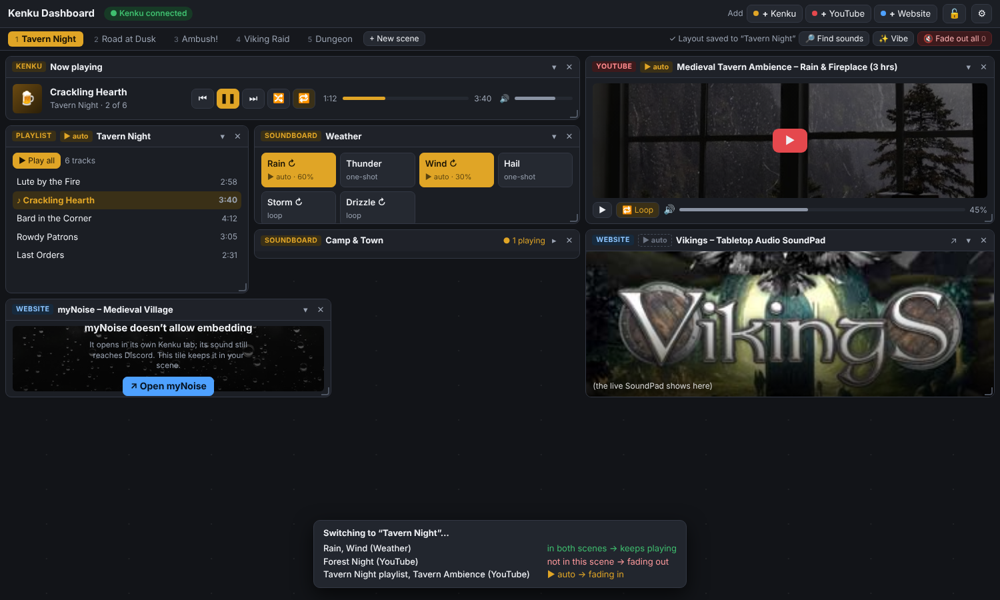
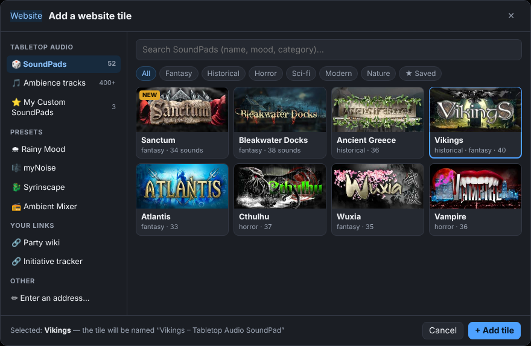

# UI redesign: tiles on a grid, scenes as layouts

Agreed design (from the Q&A of 2026-11-02/03). Mockups: `docs/mockups/`.

## The board
- A **12-column grid that stretches with the window**. On narrow screens (tablet/phone via
  "Allow other devices") tiles stack in one column.
- Everything is a **tile**: drag by its title bar, resize with handles on the edges/corner,
  **▾ collapse in place** to just its title bar (neighbours move up), ✕ close.
- **🔒 Lock** button in the top bar freezes the layout during play.
- Tile titles come from the source (YouTube video title, Kenku playlist/soundboard name,
  page title or SoundPad name). Double-click a title to rename it.
- Top bar: `+ Kenku`, `+ YouTube`, `+ Website` add buttons, 🔒, ⚙. Status light stays.
- Library: gridstack.js (MIT), copied into `dashboard/vendor/` so it works offline and with no build step.

## Tile types
| Tile | Contents |
|---|---|
| **Now playing** (Kenku) | The one shared Kenku player: track, ⏮ ▶ ⏭, shuffle, repeat, progress, volume. |
| **Playlist** (Kenku) | Track list + ▶ Play all; clicking a track plays it in the shared player. |
| **Soundboard** (Kenku) | Its sounds as pads (on/off, looping, volume). Many can play at once. |
| **YouTube** | One player (video or playlist) with play, loop, volume. |
| **Website** | An embedded site; for sites that block embedding, see below. |

## Add dialogs
- **+ Kenku**: sidebar *Now playing / Playlists / Soundboards*, search box, list with
  "on screen" marks; tick several to add at once.
- **+ YouTube**: search (existing helper search) with thumbnails, or paste a link.
- **+ Website**: sidebar
  - *Tabletop Audio*: SoundPads (search + category chips, pictures), Ambience tracks,
    My Custom SoundPads (saved share links)
  - *Presets*: myNoise, Ambient-Mixer, Rainy Mood, Syrinscape, TavernTunes, A Soft Murmur
  - *Your links*, *Enter an address…*

## Scenes = saved layouts
- A scene stores **its tiles, their positions/sizes/collapsed state, contents and settings**
  (volumes, loop, …).
- The scenes bar becomes a **thin row of tabs** (keys 1–9; 0 = fade out all), plus
  `+ New scene` (and duplicate/rename/delete from a tab's menu), 🔎 Find sounds, ✨ Vibe,
  🔇 Fade out all.
- **Auto-save**: every layout change is saved to the current scene at once; an ↶ Undo
  button covers mistakes.
- **▶ auto** tag per tile (and per soundboard sound): ticked items start when you switch
  to the scene.
- **Smart crossfade on switching**: items in both scenes keep playing without a gap;
  items only in the old scene fade out; ▶ auto items of the new scene fade in. A short
  note shows what's happening.
- **Start fresh**: old scenes aren't converted; `data/scenes.json` is kept as a backup.
  Scenes move to a new file (e.g. `data/boards.json`).

## Pop-ups (not tiles)
- 🔎 **Find sounds** (Freesound search/download) and ✨ **Vibe** open as dialogs.
- ⚙ Settings stays a dialog.

## Sites that block embedding
Tested 2026-11-03:

| Site | Embeds as-is? | Plan |
|---|---|---|
| Tabletop Audio | no (X-Frame-Options) | pass-through (built, experimental) |
| myNoise | no | pass-through: sounds load from its own site, so likely works |
| Rainy Mood | no | pass-through: its sound files play from any site, so likely works |
| Ambient-Mixer | no | Cloudflare refuses requests made by the helper (403), so expect the launcher tile |
| TavernTunes, A Soft Murmur | yes | plain embed |
| Syrinscape web player | page yes | the player needs a login, which may not work inside a tile, so fall back to the launcher tile |
| Noisli | no (DENY) | not listed |
| BattleBards | closed down | not listed |

- The pass-through becomes general: one port, with a path for each allowed site and its media
  hosts. The fixed allowlist, GET-only rule and separate port stay. It stays behind the
  ⚙ Experimental switch.
- **Mobile view**: inside a tile a site sees a small screen, so sites that adapt to screen
  size show their compact layout anyway. Through the pass-through the helper also
  identifies as a phone (mobile User-Agent), for sites that serve a separate mobile
  version (option per site).
- **Fallback launcher tile**: if a site can't be shown, the tile keeps its place in the
  scene and offers "↗ Open in a Kenku tab" (its sound still reaches Discord).

## Build order (proposal)
1. ✅ **Built.** Grid + tile framework (gridstack, collapse, lock, titles), Now playing / Playlist /
   Soundboard / YouTube / Website tiles reusing today's panel code. Notes:
   - Rows are 20px (a collapsed tile = 2 rows), so heights can be fine-tuned.
   - Now playing sizes its height to its contents; you set only its width.
   - First versions of the three Add dialogs came along (needed once the panels were gone);
     🔎 Find sounds is already a pop-up.
   - Old scenes still work on top of the tiles until step 3 replaces them.
   - The layout is stored in this browser (`localStorage`), not yet per scene.
2. Add dialogs (Kenku, YouTube with search, Website with Tabletop Audio browser + presets).
3. Scenes as layouts: tabs, auto-save, undo, ▶ auto, smart crossfade.
4. General pass-through for myNoise / Rainy Mood (+ try Ambient-Mixer), mobile UA, launcher tile.
5. Find sounds + Vibe as dialogs; README/screenshots.
